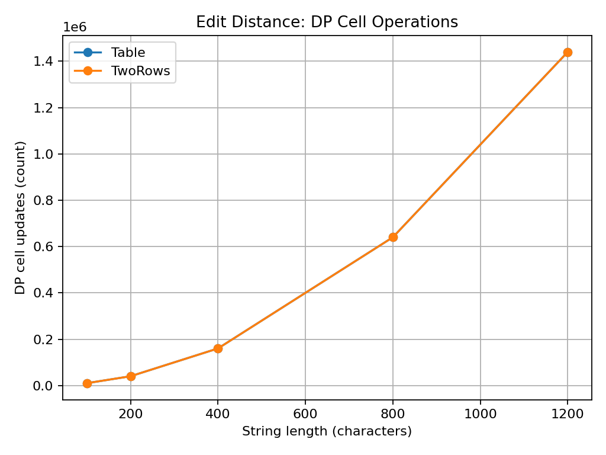
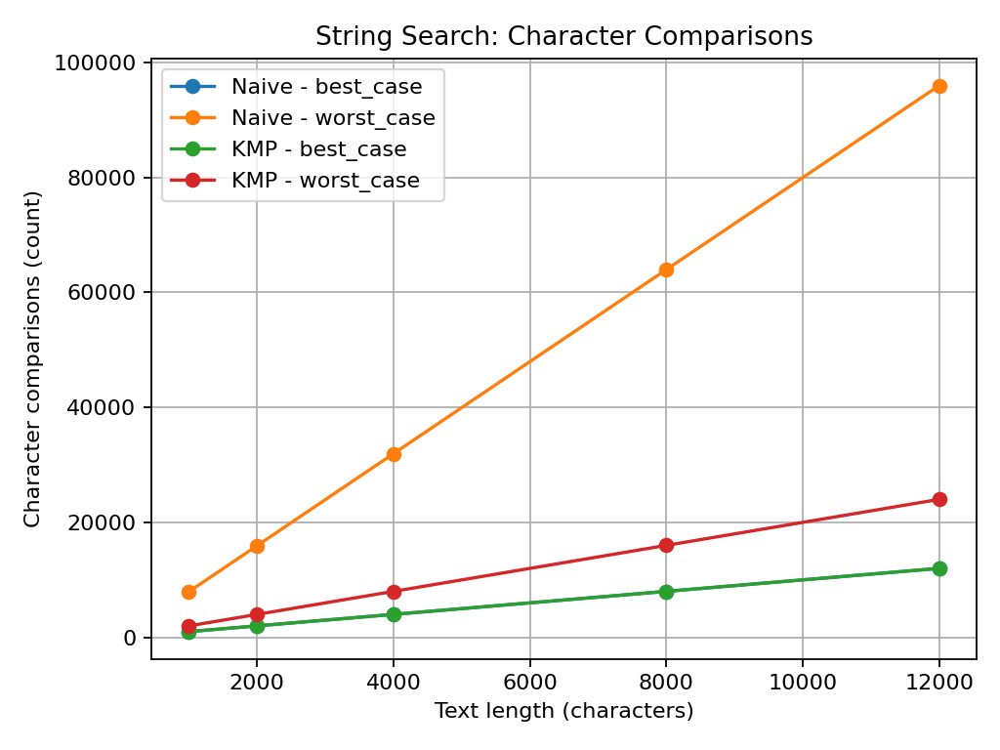
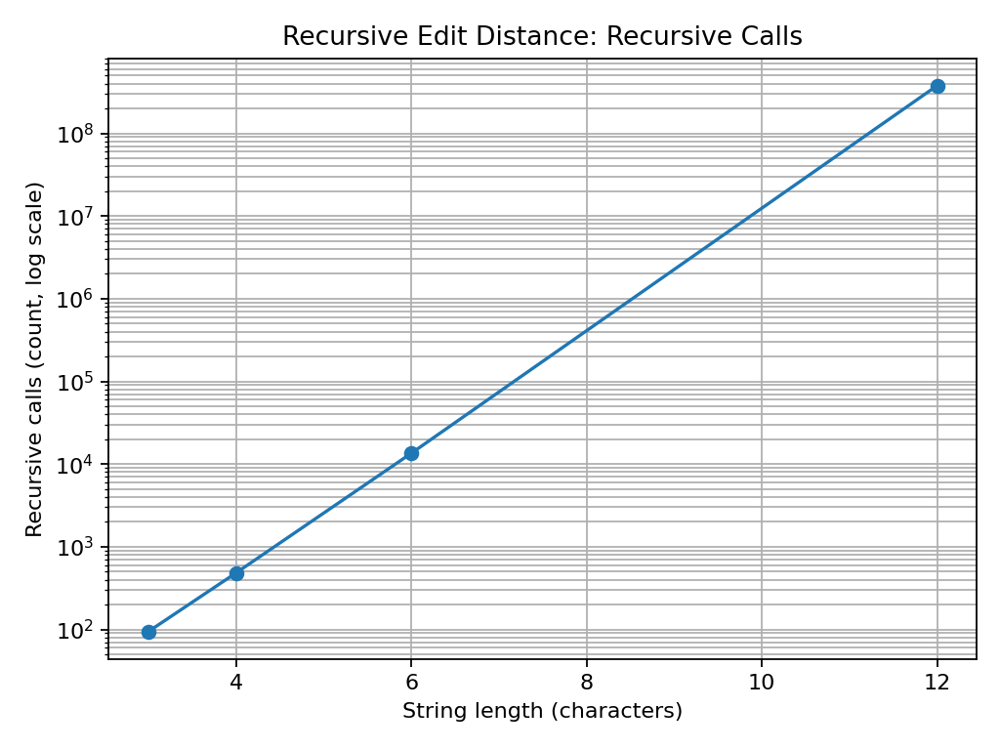
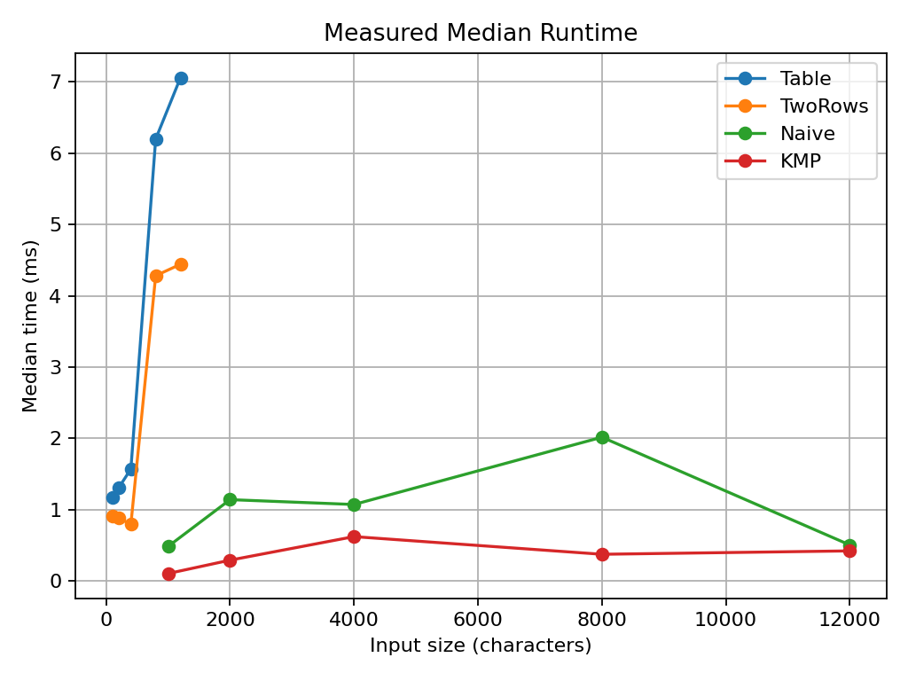

# Assignment 4 — Experiment Report

## 1. Experiment Design Card

| Field | Edit Distance | String Search |
|---|---|---|
| Question | How does the work grow for recursion and DP? Does Two Rows save memory? | How do Naive and KMP behave on easy and difficult patterns? |
| Sizes | Recursive: 3, 4, 6, 12. Table/Two Rows: 100, 200, 400, 800, 1200. | 1000, 2000, 4000, 8000, 12000 characters. |
| Inputs | Fixed-seed random strings; completely different strings (`aaaa...` and `bbbb...`). | Best case: text contains `b`, pattern contains `a`. Worst case: text is all `a`, pattern is `aaaaaaab`. |
| Metrics | Recursive calls or DP cells; median time of 3 runs. | Character comparisons; median time of 3 runs. |
| Prediction | Recursive calls will grow very fast. Table and Two Rows will do about n × n cells. Two Rows will use less memory. | KMP will do fewer comparisons on the repeated-prefix worst case. Naive will be simple but can repeat comparisons. |
| Plots | DP operation counts, recursive calls (log scale), and measured time. | Search comparisons for best and worst cases. |

The generator uses the fixed seed `42`, so random inputs are repeatable. Time is the median of three runs. Very small times are reported in milliseconds with decimal places.

## 2. Results and Plots

### Plot 1 — DP cell operations

**Takeaway:** Table and Two Rows calculate the same number of DP cells, which grows quadratically with input size. Two Rows changes memory use, not the number of calculations.

### Plot 2 — String-search comparisons

**Takeaway:** On the worst-case input, Naive repeats comparisons near each starting position, while KMP avoids much of this repeated work. In the best case both methods quickly reject each position.

### Plot 3 — Recursive calls

**Takeaway:** Recursive calls increase extremely quickly. The size-12 test already needs hundreds of millions of calls, so larger inputs are not practical for this version.

### Plot 4 — Measured time

**Takeaway:** The measured time generally grows with input size, but small timings can fluctuate because of JVM warm-up and the computer. Counters provide more stable evidence of algorithm work.

## 3. Prediction vs Result

For Edit Distance, I expected recursion to be much slower because it solves the same smaller problems many times. The counter confirms this: at size 12 it makes 377,393,953 calls. Table and Two Rows both calculate n × m cells; the two-row method keeps only two arrays, so it uses O(m) extra memory instead of O(n × m).

For String Search, I expected KMP to be better on repeated-prefix input. The comparison counter supports this: on the worst-case input Naive performs about eight comparisons per text position, while KMP stays close to a linear number. Runtime values are less stable than counters, especially for short runs.

## 4. Short Answers

**1. Which input made your string search slowest, and why?**
The worst-case input was a text made of `a` characters and the pattern `aaaaaaab`. Naive matches several characters and then fails at the last character. It starts again at the next position and repeats almost the same comparisons. KMP uses the LPS array to avoid checking the same prefix again.

**2. How large an n could the recursive Edit Distance handle, and what stopped it?**
In this experiment, I tested up to n = 12. It already needed about 377 million recursive calls and around one second on this computer. Larger inputs grow too slowly to be practical because recursion repeats many subproblems.

**3. What do you gain and lose when you use two rows instead of the full table?**
Two Rows uses much less extra memory: O(m) instead of O(n × m). It still gives the same edit-distance answer and performs the same number of DP cell calculations. The disadvantage is that the full table is not saved, so it is harder to reconstruct the exact edit operations afterward.

**4. If you had to choose one string search for your city platform, which one and why?**
I would choose KMP. It is efficient for long text and does not move backwards in the text. It also handles repeated patterns and overlapping matches correctly.

## 5. One Paragraph on Time

The measured times usually increased as the input became larger, especially for the recursive version. However, some small measurements were close to zero and the order between Table and Two Rows sometimes changed. This can happen because the Java Virtual Machine warms up and because the computer is doing other work. Therefore, I also used counters: recursive calls, DP cells and character comparisons. Counters show the amount of algorithm work more clearly than one timing result.
